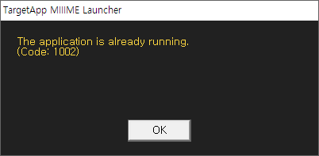

# MIIIME Hybrid Launcher (MHL™)

MIIIMELauncher · 미메런처 · ミメランチャー<br>


[](https://www.autoitscript.com/site/)


<br>

<br>

This is Portable Launcher.  
Not recommended unless you have a thorough understanding of file systems and registry structures.

포터블런쳐입니다. 
파일 시스템 및 레지스트리 구조에 대한 이해가 없는 경우 사용을 권장하지 않습니다.  

<br>

<br>

---

## Technical Stack

* **Core Engine** : AutoIt3, WinAPI (Kernel32, User32, Advapi32), GDI+
* **Process Management** : WMI (Windows Management Instrumentation) query-based monitoring.
* **FileSystem** : NTFS Junction Points (Reparse Points) & Physical Fallback.
* **Registry** : Native Hive Injection/Retrieval via Regedit / reg.exe binaries (32-bit and 64-bit registry views).

---

## Mechanism

### 1. Filesystem Virtualization

- **NTFS** : Junction Point (Symbolic Link) redirection.  
- **Non-NTFS** : Automatic fallback to Physical Swap mode.  
- **Robustness** : Smart retry logic for locked files during transition.

**[파일 시스템 가상화]**

- **NTFS** : Junction Point (심볼릭 링크) 리다이렉션 사용.  
- **Non-NTFS** : 물리적 Swap 모드로 자동 전환.
- **안전성** : 파일 잠김 발생 시 스마트 재시도 로직을 통해 데이터 무결성 보장.

### 2. Registry Management

- **Injection** : Seamless integration of HKCU / HKLM keys.
- **Registry Views** : On 64-bit Windows, keys under HKLM `\SOFTWARE` are split into a 32-bit view and a 64-bit view. With `RegBothViews=1` (default) both views are backed up, injected, exported, deleted and restored. Without it, only the launcher's own bitness view is handled. The `.reg` templates are kept in `Reg_x86` (32-bit view) and `Reg_x64` (64-bit view); other keys (HKCU etc.) use `Reg`.
- **Integrity** : Hashing (MD5) applied to long key paths during backup.
- **Cleanup** : Root key pruning and verified retrieval.
- **Trace** : Optional deletion of execution traces (MUICache, UserAssist) on exit.
- **Shared Area** : Optional deletion, on exit, of values with matching names in registry areas shared by several programs (e.g. `OpenWithProgids`). Host-owned values are protected.
- **Conflict Check** : If another launcher is using the same registry key, the launch is stopped with a warning.

**[레지스트리 관리]**

- **주입** : HKCU / HKLM 키의 무결절 통합.
- **레지스트리 뷰** : 64비트 Windows 에서 HKLM `\SOFTWARE` 아래 키는 32비트 뷰와 64비트 뷰로 나뉨. `RegBothViews=1` (기본) 이면 두 뷰를 모두 백업 · 주입 · 내보내기 · 삭제 · 복원하고, 0 이면 런처 비트의 뷰만 처리. `.reg` 템플릿은 `Reg_x86` (32비트 뷰) 와 `Reg_x64` (64비트 뷰) 에 따로 보관하며, 그 밖의 키 (HKCU 등) 는 `Reg` 를 사용.
- **무결성** : 백업 시 긴 키 경로에 대한 해싱(MD5) 적용.
- **정리** : 루트 키 가지치기 및 검증된 회수 수행.
- **흔적** : 종료 시 실행 흔적(MUICache, UserAssist) 선택적 삭제.
- **공용 영역** : 여러 프로그램이 함께 쓰는 레지스트리 영역(예: `OpenWithProgids`)에서 이름이 일치하는 값만 종료 시 선택적 삭제. 호스트 소유 값은 보호.
- **충돌 검사** : 다른 런처가 같은 레지스트리 키를 사용 중이면 경고 후 실행 중단.

### 3. Forensic Recovery

- **Session Tracking** : Validates session integrity via UUID and PID monitoring.
- **Rollback** : Transaction-based recovery using snapshots.
- **AppData Recovery** : On next launch, detects folders left by abnormal termination, removes orphaned Junction Points, and restores the original AppData directories automatically. 

**[포렌식 복구]**

- **세션 추적** : UUID 및 PID 모니터링을 통한 세션 무결성 검증.
- **롤백** : 트랜잭션 기반의 스냅샷을 이용한 복구.
- **AppData 복구** : 다음 실행 시 비정상 종료로 잔류한 폴더를 자동 탐지, 고아 Junction을 제거하고 원본 AppData를 복원. 

### 4. Shell Integration

- **File Association** : Registers extension / ProgID / icon / open command on launch and removes them on exit (HKCU by default, HKLM optional).  
- **Shell Extension** : Registers COM shell extension DLLs (context menu / drag-and-drop / property sheet handlers; HKLM, requires administrator rights). Apps with more than one server DLL are supported (a DLL can be set per CLSID).  
- **Host Protection** : Host keys are backed up before writing and restored on exit. `HostSkip` skips registration when the host already has its own installation.

**[셸 통합]**

- **파일 연결** : 실행 시 확장자 / ProgID / 아이콘 / 열기 명령을 등록하고 종료 시 제거 (기본 HKCU, HKLM 선택).
- **셸 확장** : COM 셸 확장 DLL 등록 (우클릭 / 드래그 / 속성 시트 핸들러. HKLM, 관리자 권한 필요). 서버 DLL 이 둘 이상인 앱도 지원 (CLSID 별로 DLL 지정 가능).
- **호스트 보호** : 쓰기 전 호스트 키를 백업하고 종료 시 복원. `HostSkip` 으로 호스트 설치본이 있으면 등록을 건너뜀.

### 5. Multiple Instances

- **Primary / Secondary** : With `AllowMultipleInstances=1`, the first launcher is the primary instance and later launchers are secondary instances. Secondary instances reuse the environment prepared by the primary and skip recovery, injection, registration and cleanup.  
- **Cleanup** : The primary instance waits until every target exe in its folder has exited, then performs the cleanup once.

**[다중 인스턴스]**

- **주 / 보조** : `AllowMultipleInstances=1` 이면 먼저 실행된 런처가 주 인스턴스, 이후 런처는 보조 인스턴스. 보조 인스턴스는 주 인스턴스가 만든 환경을 그대로 쓰며 복구 · 주입 · 등록 · 정리를 하지 않음.
- **정리** : 주 인스턴스가 폴더 안의 타겟 exe 가 모두 종료될 때까지 기다린 뒤 정리를 한 번만 수행.

---

## Configuration

### 1. Quick Setup

- **Naming Convention** : The launcher executable and INI file must have the same name (e.g., `TargetApp_M.exe` and `TargetApp_M.ini`). For management and identification, filenames must include the `_M` suffix.
- **Bitness** : Build the launcher per bitness (x86 portable = x86 launcher, x64 portable = x64 launcher). A launcher handles its own bitness's registry view by default. The target's bitness may differ (set `RegBothViews=1` to handle both views).
- **INI Lookup** : For `TargetApp_x64_M.exe` / `TargetApp_x86_M.exe`, the first existing INI is used: own bitness -> `TargetApp_M.ini` -> other bitness.

**[빠른 설정]**

- **네이밍 규칙** : 런처 실행 파일과 INI 파일은 같은 이름이어야 함 (예: `TargetApp_M.exe` 및 `TargetApp_M.ini`). 
  관리 및 식별을 위해 파일명에 `_M` 접미사를 반드시 포함해야 함.  
- **비트** : 런처를 비트별로 따로 빌드 (x86 포터블 = x86 런처, x64 포터블 = x64 런처). 런처는 기본적으로 자기 비트의 레지스트리 뷰를 처리함. 타겟 비트는 달라도 됨 (두 뷰를 모두 처리하려면 `RegBothViews=1`).
- **INI 탐색** : `TargetApp_x64_M.exe` / `TargetApp_x86_M.exe` 이면 자기 비트 -> `TargetApp_M.ini` -> 다른 비트 순으로 처음 존재하는 INI 사용.

### 2. Directory Structure

```text
TargetApp_M/
     │
     ├─ TargetApp_M.exe             # Launcher Executable / 런처 실행 파일
     ├─ TargetApp_M.ini             # Configuration File / 설정 파일
     ├─ TargetApp_M.log             # Runtime Log / 실행 로그 (활성 시 생성)
     │
     ├─ App/                        # Core Files & Templates / 핵심 파일 및 템플릿
     │   │     
     │   ├─ TargetApp/              # Target Application / 원본 타겟 앱 바이너리
     │   │
     │   ├─ Ext/                    # Extra / 추가 파일
     │   │   ├─ Ast/                # Assets File Injection / 주입용 어셋 파일
     │   │   ├─ Env/                # Environment File / 환경설정용 파일    
     │   │   └─ Res/                # UI Resources / 폴더아이콘, 스플래시 이미지
     │   │
     │   └─ RawDat/                 # Default Data Template / 데이터 초기 템플릿
     │       ├─ AppDat/             # System AppData Sandbox / 시스템 앱 데이터 샌드박스
     │       │   ├─ Local/          # %LocalAppData% 대체
     │       │   ├─ LocalLow/       # %LocalLow% 대체
     │       │   └─ Roaming/        # %AppData% 대체
     │       ├─ Reg/                # Registry Templates (HKCU etc.) / 주입용 .reg 템플릿 (HKCU 등)
     │       ├─ Reg_x86/            # Registry Templates, HKLM\SOFTWARE 32-bit view / 주입용 .reg 템플릿 (HKLM\SOFTWARE 32비트 뷰)
     │       ├─ Reg_x64/            # Registry Templates, HKLM\SOFTWARE 64-bit view / 주입용 .reg 템플릿 (HKLM\SOFTWARE 64비트 뷰)
     │       ├─ Set/                # Portable Settings / 앱 폴더 병합용 설정 파일 
     │       └─ Usr/                # User File / 사용자 파일 *    
     │
     └─ Dat/                        # Active User Data / 사용자 저장소 (수정 사항 저장)

            * Usr folder is for ADVANCED USERS ONLY.
            * Usr 폴더는 고급 사용자 전용.
```

**[디렉토리 구조]**

* **런처 실행 파일** : 런처 본체 및 동작 환경 정의를 위한 설정 파일.
* **App 영역** : 원본 앱 바이너리 및 사용자 데이터 초기 상태를 위한 템플릿.
* **Dat 영역** : 사용자가 수정한 사항이 저장되는 실제 데이터 저장소.


### 3. Technical Specification (`ini`)

#### **[INI Parameters] (`TargetApp_M.ini`)**

Key configuration values for the launcher behavior.  
런처 동작을 제어하는 주요 설정 값. 

| Parameter                | Section  | Type | Description                                                                                                                    |
| ------------------------ | -------- | ---- | ------------------------------------------------------------------------------------------------------------------------------ |
| `RunAsAdmin`             | Launch   | Bool | 1=Force Administrator privileges, 0=User mode                                                                                  |
| `UseJunction`            | Options  | Bool | **1=Symbolic Link (Recommended)**, 0=Physical Copy mode                                                                        |
| `FreezeMode`             | Options  | Bool | 1=Non-persistent (Volatile / Read-Only), 0=Persistent. **Requires `UseJunction=0`.** Mutually exclusive with Junction mode.    |
| `ExitNotice`             | Options  | Bool | 1=Show a completion message (OK button) after exit and cleanup have fully finished, 0=Off (default). Primary shows `Session Terminated. [Primary]`, secondary shows `[Secondary]` |
| `LogLevel`               | Options  | Int  | 0=Off (default), 1=All including DEBUG, 2=INFO and above, 3=WARN and above, 4=ERROR only. Values outside 0–4 are treated as 0. |
| `PreLaunchDelay`         | Advanced | Int  | Wait time (ms) after all preparation and right before launching the target (default: `0`, max `60000`). Secondary instances do not wait |
| `PostLaunchDelay`        | Advanced | Int  | Wait time (ms) after app exit is detected and before cleanup starts, applied before any other wait setting (default: `0`, max `60000`). Secondary instances do not wait |
| `ProcessCheckInterval`   | Advanced | Int  | Polling interval (ms) for child process monitoring (default: `200`)                                                            |
| `ExitThreshold`          | Advanced | Int  | Consecutive missed polls before process exit is declared (default: `2`)                                                        |
| `CrashRecovery`          | Launch   | Bool | 1=Auto-recover orphaned `_bakk` folders on next launch (default), 0=Disabled                                                   |
| `AllowMultipleInstances` | Launch   | Bool | 1=Allow multiple concurrent instances (first launcher = primary, later ones = secondary; recovery, injection and cleanup are done once by the primary), 0=Block (default) |
| `DetectReadOnly`         | Options  | Bool | 1=Check for read-only media and exit with a message if detected (default), 0=Skip the check |
| `RegBothViews`           | Options  | Bool | 1=Handle keys under HKLM `\SOFTWARE` in both the 32-bit and 64-bit registry views (default, 64-bit Windows only), 0=Launcher's own bitness view only. `.reg` templates: `Reg_x86` / `Reg_x64` |
| `AddCommand`             | Options  | Str  | Additional command-line arguments appended to the target executable on launch                                                  |
| `WorkDir`                | Launch   | Str  | Working directory for the target executable (default: same directory as `{Run}`)                                               |

#### **[Path Override] Sections**

| Section         | Description                                                                                                                                                                                 |
| --------------- | ------------------------------------------------------------------------------------------------------------------------------------------------------------------------------------------- |
| `[Directories]` | Override default directory layout. Keys: `RunPath` (default: `App\TargetApp`), `RawDataPath` (`App\RawDat`), `ExtPath` (`App\Ext`), `DataPath` (`Dat`). All paths relative to the launcher. |
| `[Environment]` | Environment variables and shared paths. Keys `CommonFilesDir` (default: `..\CommonFiles`) and `_MIIIMEEnvDir` (default: `..\_MIIIMEEnv`) override the `{CommonFiles}` / `{_MIIIMEEnv}` macro paths. Any other `NAME=value` sets an environment variable for the target; `PATH01`–`PATH99` extend `PATH`. Macros can be used in values. |

#### **[Process] Sections**

| Section          | Description                                                                                                                                    |
| ---------------- | ---------------------------------------------------------------------------------------------------------------------------------------------- |
| `[ProcessWatch]` | Additional processes to monitor alongside the main executable (for multi-process apps). Cleanup begins when all watched processes have exited. |
| `[ProcessKill]`  | Processes to forcefully terminate before cleanup. Restricted to executables within `{Run}`.                                                    |

#### **[Registry] Sections**

| Section           | Description                                                                                                                                                                                                                               |
| ----------------- | ----------------------------------------------------------------------------------------------------------------------------------------------------------------------------------------------------------------------------------------- |
| `[Registry]`      | Registry keys (HKCU / HKLM `\SOFTWARE`) to back up on launch, inject from `.reg` files (named after the INI key, e.g. `01=` → `01.reg`), retrieve on exit, and delete from host. Keys under HKLM `\SOFTWARE` use `Dat\Reg_x86\` (32-bit view) and `Dat\Reg_x64\` (64-bit view); other keys (HKCU etc.) use `Dat\Reg\`. If the matching folder does not exist, backup and delete only (no injection — clean state mode). Shared areas (`Explorer\FileExts\...`, `OpenWithProgids`, `OpenWithList`) are ignored; use `[SharedClean]`. Supports `SmartSkip` (default: `0`). |
| `[RegistryRoot]`  | Parent keys to prune if empty after `[Registry]` cleanup (both views with `RegBothViews=1`). Supports `SmartSkip` (default: `0`).                                                                                                                                            |
| `[RegistryShell]` | Shell context menu entries to register on launch and remove on exit. Supports `SmartSkip` (default: `0`).                                                                                                                                 |
| `[RegistryAssoc]` | File associations (extension → ProgID → open command / icon) registered on launch and removed on exit. HKCU by default, `Scope=HKLM` for HKLM (admin). `HostSkip=1` skips the section when the host already has the same ProgID. Supports `SmartSkip` (default: `0`). |
| `[ShellExt]`      | COM shell extensions (context menu / drag-and-drop / property sheet handlers; HKLM, admin required). Server DLL via `Dll=`, or per CLSID with the optional 3rd field (`CLSID\|{GUID}\|{Run}\Other.dll`) for multi-DLL apps. `HostSkip=1` protects a host install. Supports `SmartSkip` (default: `0`). |
| `[RegistryFix]`   | Key\|Value\|Data entries to force-write on every launch (path patching). Supports `SmartSkip` (default: `1`).                                                                                                                             |

#### **[Filesystem] Sections**

| Section            | Description                                                                                                                                                                             |
| ------------------ | --------------------------------------------------------------------------------------------------------------------------------------------------------------------------------------- |
| `[FileWrite]`      | In-place file patching on launch: string replace/append, or key-value line update (Type A/B/C). Wildcard path supported. Supports `SmartSkip` (default: `1`).                           |
| `[CleanupExclude]` | Keep only the listed items in a folder and delete the rest (wildcards supported). Targets local absolute paths allowed by the built-in safety guard; runs on exit. Supports `SmartSkip` (default: `2`). |
| `[CleanupDelete]`  | Files/folders to delete on exit (wildcards supported). Targets local absolute paths allowed by the built-in safety guard. Supports `SmartSkip` (default: `2`). |
| `[Assets]`         | Files to inject into `{Run}` or `{Dat}`. Supports `SmartSkip` (default: `1` = on environment change). `SmartSkip=0` forces overwrite on every launch; `SmartSkip=2` disables injection. |
| `[UserFile]`       | Files to copy into host directories on launch and restore on exit. **Advanced users only.** Admin privileges may be required depending on target paths.                                 |

#### **[Post-App] Sections**

| Section           | Description                                                                                                                                                         |
| ----------------- | ------------------------------------------------------------------------------------------------------------------------------------------------------------------- |
| `[ShortcutGuard]` | Protects same-named shortcuts/folders (`_bakk` backup before launch, restore after exit) and deletes ones the app re-creates after exit. Parameters: `Name` (list of folder or `.lnk` names, `\|Name1\|Name2\|` format), `Wait` (post-exit watch in sec, default `10`), `Interval` (poll interval in ms, default `500`). |
| `[SharedClean]`   | On exit, deletes only registry values whose **name** matches, in areas shared by several programs (default, HKCU only: `Classes` and `Explorer\FileExts`, down to `OpenWithProgids`). One-way delete (no backup / restore); values that already existed at launch are protected; nameless (Default) values and keys are never deleted. Parameters: `SmartSkip` (`0`/`1`=enable, `2`=disable, default: `2`), `Name` (`\|WinMount.~\|` format, wildcards `~` `^`, at least 3 literal characters). |
| `[TraceClean]`    | Deletes execution traces (MUICache, UserAssist) of the target exe and/or launcher on exit. Parameters: `SmartSkip` (`0`/`1`=enable, `2`=disable, default: `2`), `Name` (`\|{Exe}\|`, `\|{Launcher}\|` or `\|{Exe}\|{Launcher}\|`), and timing options `TraceCleanWait` / `TraceCleanIdleWait` / `TraceCleanPollMs` / `TraceCleanStepDelay`. |
| `[Resources]`     | Applies folder icon and splash image from `Ext\Res\`. Supports `SmartSkip` (default: `1`).                                                                          |

#### **[SmartSkip] Control**
 
`SmartSkip` control specifies whether the section executes.  
스마트스킵 컨트롤은 다음 섹션의 실행 여부를 지정. 

`[Registry]`, `[RegistryRoot]`, `[RegistryShell]`, `[RegistryAssoc]`, `[ShellExt]`, `[RegistryFix]`, `[FileWrite]`, `[CleanupExclude]`, `[CleanupDelete]`, `[Assets]`, `[UserFile]`, `[SharedClean]`, `[TraceClean]`, `[Resources]`

| Value | Behavior                                                                          |
| ----- | --------------------------------------------------------------------------------- |
| `0`   | Always execute                                                                    |
| `1`   | Execute only when environment change is detected (drive path, hostname, or user name changed) |
| `2`   | Always skip — disabled                                                            |

#### **[Environment] & Macros**

Supports a macro system for path flexibility.  
경로 유연성을 위해 매크로 시스템을 지원.

* **Launcher** : `{Base}`, `{Run}`, `{Raw}`, `{Dat}`, `{Ast}`, `{Env}`, `{Res}`, `{Ext}`, `{Usr}`, `{Exe}`, `{Launcher}`, `{ExeROT13}`, `{LauncherROT13}`, `{AppName}`, `{CommonFiles}`, `{_MIIIMEEnv}`
* **System** : `{Windows}`, `{System32}`, `{SysWOW64}`, `{ProgramFiles}`, `{ProgramFiles(x86)}`, `{ProgramData}`, `{UserProfile}`, `{Docs}`, `{Desktop}`, `{StartMenu}`, `{Programs}`, `{CommonStartMenu}`, `{CommonPrograms}`, `{Temp}`
* **AppData** : `{Local}`, `{LocalLow}`, `{Roaming}`

---

## CLI Arguments

Supported command-line arguments for debugging and maintenance.  
디버깅 및 유지보수를 위해 지원되는 명령줄 인수.

```bash
TargetApp_M.exe [Options]
```

| Argument  | Description                                                                                                                    |
| --------- | ------------------------------------------------------------------------------------------------------------------------------ |
| `--clean` | **Force Cleanup**: Deletes the entire `Dat/` directory (including all user data) and resets the environment. **Irreversible.** Ignored in `FreezeMode`. |
| `--debug` | **Debug Mode**: Forces `LogLevel=1` (all logs including DEBUG) regardless of INI settings.                                     |

Any other argument is passed through to the target application.  
그 밖의 인수는 타겟 앱에 그대로 전달됨.

---

## Companion Tools

Standalone companion utilities are provided alongside MHL.  
미메런처의 운영을 보조하는 독립 도구를 제공함.  

> ### MIIIME Icon Changer (MIC)
> 
> Change the icon of the launcher executable file after portable wrapping.  
> 포터블 래핑 후 런쳐실행파일의 아이콘을 변경.

- **Repository** : [MIIIMEIconChanger](https://github.com/miiimeworks/MIC)

> ### MIIIME Universal Cleaner (MUC)
> 
> A tool that cleans up unnecessary files and folders according to rules defined in an INI configuration file.  
> INI 설정 파일에 정의된 규칙에 따라 불필요한 파일과 폴더를 청소.  

- **Repository** : [MIIIMEUniversalCleaner](https://github.com/miiimeworks/MUC)

> ### MIIIME Launcher Sweeper (MLS)
> 
> A forensic cleanup utility that detects and removes filesystem artifacts left by abnormal launcher termination.  
> 런처의 비정상 종료 후 호스트에 잔류한 파일시스템 아티팩트를 포렌식 탐지 · 제거.  

- **Repository** : [MIIIMELauncherSweeper](https://github.com/miiimeworks/MLS)

> ### MIIIME Tools Manager (MTM)
> 
> A live monitoring and management tool for launcher processes and their host-side traces.  
> 런처 프로세스와 호스트 흔적을 실시간 모니터링하고 정리.  

- **Repository** : [MIIIMEToolsManager](https://github.com/miiimeworks/MTM)

---

## 🛡️ Security & Anti-virus Info

### [✅ VirusTotal Analysis Report](https://www.virustotal.com/gui/file/500b3e7f3b570973d34f499f7e7f8db6fb9adeffdda94acab7adbe25ee2b698d?nocache=1)

| Status             | Details                                                                        |
|:------------------ |:------------------------------------------------------------------------------ |
| **Major Vendors**  | **Clean** (Passed by AhnLab V3, Kaspersky, Microsoft, Avast, ESET, etc.)       |
| **Detection Rate** | **4 / 71** (Mostly Heuristic/Generic/Trojan-type flags)                        |
| **Integrity**      | Private project; verified via hashes and VT results. 						  |

> This Program was created with AutoIt. Some antivirus programs may incorrectly detect it as a virus.  
> 본 프로그램은 AutoIt으로 제작되었습니다. 일부 백신이 바이러스로 오진 할 수 있습니다. 

**File Checksum (SHA-256) :** `500b3e7f3b570973d34f499f7e7f8db6fb9adeffdda94acab7adbe25ee2b698d`

---

## Disclaimer

Provided **“AS IS”**, without warranty.  
This is a **private project**. No technical support is provided.

본 프로그램은 **“있는 그대로”** 제공되며, 사용 중 발생하는 문제에 대해 제작자는 책임을 지지 않습니다.  
기술 지원은 제공되지 않습니다.

---

## Project Information

**Developer** : MIIIME  
**Website** : https://www.miiime.com  
**GitHub** : [@miiimeworks](https://github.com/miiimeworks)  
**Last Update** : 2026-11-19   

<br>
  
<br>
<br>
<br>